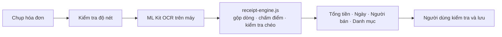

# FinBud – Trợ lý Quản lý Chi tiêu Thông minh cho Sinh viên

> **FinBud** là ứng dụng di động (Android / Capacitor) giúp sinh viên gạt bỏ rào cản ghi chép thủ công tốn thời gian, giải quyết bài toán mất kiểm soát tài chính tức thời thông qua con số định mức chi tiêu an toàn mỗi ngày: **"Hôm nay mình có thể chi tiêu bao nhiêu tiền?"**

Sản phẩm được nghiên cứu và phát triển theo quy trình Design Thinking bởi nhóm **TNN Innovators** khóa 24SE (Viện Nghiên cứu và Đào tạo Việt - Anh, Đại học Đà Nẵng).

---

## Vấn đề & Giải pháp cốt lõi

* **Vấn đề thực tế:** 61,5% sinh viên gặp khó khăn vì có quá nhiều giao dịch nhỏ lẻ và 42,3% dễ quên ghi chép. Các ứng dụng ngân hàng hiện tại chỉ hiển thị số dư và lịch sử giao dịch trong quá khứ, không hỗ trợ đưa ra quyết định chi tiêu ngay tại thời điểm mua sắm.
* **Cách FinBud giải quyết:**
  * **Zero-effort Input:** Nhập liệu đa phương thức bằng AI chạy trên máy (giọng nói tiếng Việt offline, quét hóa đơn, tự phân loại danh mục).
  * **Daily Safe-to-Spend:** Chuyển dữ liệu tài chính phức tạp thành một con số duy nhất: hạn mức chi tiêu khả dụng trong ngày.

---

## Tính năng hiện có

### 1. Daily Spending Widget & Thuật toán Rolling Budget
* **Con số thời gian thực:** Hiển thị số tiền bạn được phép chi trong ngày hôm nay.
* **Cảnh báo 3 cấp độ màu:**
  * **Xanh:** An toàn (< 80% hạn mức ngày).
  * **Vàng:** Sắp chạm trần (80% – 100% hạn mức).
  * **Đỏ:** Vượt hạn mức ngày.
* **Cân bằng động (Dynamic Rolling Budget):**

  $$\text{Hạn mức ngày} = \frac{\text{Có thể chi} - \text{Đã tiêu trước hôm nay}}{\text{Số ngày còn lại trong tháng}}$$

  $$\text{Có thể chi} = \text{Ngân sách tháng} - \text{Chi phí cố định} + \text{Tiền thêm trong tháng}$$

  * Chi **vượt mức** hôm nay → phần thâm hụt tự động chia đều vào các ngày còn lại.
  * Chi **tiết kiệm** → khoản dư dồn sang các ngày sau.
* Khối hạn mức còn hiện hạn mức dự kiến của ngày mai.

### 2. Thêm tiền có thể chi
* Thẻ **"Tiền thêm tháng này"** ngay trên trang chủ, bấm **Thêm tiền** để ghi các khoản như bố mẹ gửi, làm thêm, được thưởng.
* Chọn nhanh `+50k / +100k / +200k / +500k`, ghi nguồn tiền (không bắt buộc); nút **Thêm** cho biết hạn mức hôm nay tăng bao nhiêu.
* Khoản tiền thêm chỉ cộng vào tháng hiện tại. Danh sách các lần đã thêm nằm trong bảng Thêm tiền, chạm để xóa.

### 3. Nhập nhanh bằng giọng nói tiếng Việt (Offline – Vosk)
* **Chạy hoàn toàn trên máy:** Model Vosk tiếng Việt được đóng gói trong APK, nhận diện bằng CPU điện thoại, không cần mạng.
* **Một ô nhập duy nhất:** gõ hoặc bấm **Nói** ngay trong ô; nói xong hoặc bấm Enter là app tự phân tích.
* **Hiểu cách nói của sinh viên:**
  * *"ăn bún bò 35k"* → 35.000đ
  * *"gửi xe hai chục"* → 20.000đ
  * *"mua áo 5 xị"* → 500.000đ
  * *"đi grab nửa triệu"* → 500.000đ
  * *"photo tài liệu ba lăm nghìn"* → 35.000đ
  * Cũng đọc được số dạng `45.000 VND`, `2 triệu rưỡi`, và dán được nội dung thông báo ngân hàng vào ô nhập.
* **Tự phân loại danh mục** bằng mô hình chạy trên máy (xem [mục 5](#5-phân-loại-danh-mục-chi-tiêu)).
* **Kiểm tra trước khi lưu:** thẻ kết quả hiện số tiền lớn, danh mục dạng nút chọn và ghi chú sửa được; chỉ lưu khi bấm **Lưu**.
* **Dự phòng:** nếu máy không chạy được Vosk, app dùng Web Speech API (nếu có), hoặc bạn bấm micro trên bàn phím rồi bấm Enter.

### 4. Quét hóa đơn bán lẻ (OCR chạy trên máy)
Chụp hóa đơn → app tự điền **tổng tiền, ngày, người bán và danh mục**, bạn kiểm tra rồi lưu.



* **OCR offline:** Plugin `ReceiptScanner` dùng Google ML Kit (bộ chữ Latin, gồm tiếng Việt), model đóng gói sẵn trong APK nên quét được khi không có mạng.
* **Trích xuất thông minh (`receipt-engine.js`):** gộp các ô chữ thành từng hàng, chấm điểm hàng "Tổng cộng / Thanh toán", loại trừ hàng "Tiền mặt / Tiền thừa / Giảm giá", và kiểm tra chéo *tiền khách đưa − tiền thừa = tổng*. Số bị OCR đọc nhầm (ví dụ `1O5,OOO`) được sửa lại.
* **Phân loại chi tiêu:** dùng chung bộ phân loại với Nói / gõ, dựa trên tên cửa hàng và nội dung hóa đơn.
* **Khi chưa chắc chắn:** app hiện 2–3 số tiền ứng viên để chạm chọn và nhắc kiểm tra kỹ.
* **Ngày trên hóa đơn:** được dùng làm ngày giao dịch nếu không quá 45 ngày, nếu cũ hơn thì ghi theo hôm nay.
* **Kiểm tra độ nét ảnh** (Laplacian) cảnh báo khi ảnh mờ.
* **Dự phòng:** nếu ML Kit không dùng được thì thử Tesseract.js (cần mạng lần đầu); không đọc được thì mở sẵn ô nhập tay.
* Nút **Sao chép JSON OCR** giúp thu thập mẫu thật để đánh giá và cải thiện mô hình.

### 5. Phân loại danh mục chi tiêu
* **7 danh mục**, mỗi danh mục một màu: Ăn uống, Di chuyển, Học tập, Mua sắm, Sức khỏe, Giải trí, Khác.
* Tiền nhà, điện, nước, mạng đã nằm trong **Chi phí cố định** nên không có danh mục riêng; nếu nhập vào sẽ được xếp vào Khác.
* **Một bộ phân loại chung** cho Nói / gõ, Quét hóa đơn và Giả lập thông báo: mô hình TF-IDF n-gram ký tự + hồi quy logistic, nếu độ tin cậy thấp thì dùng từ điển. Chạy trên máy, không cần mạng.
* **Kết quả trên bộ test viết tay 193 câu:** đúng **96,4%** (mô hình cũ: 26,9%); riêng các câu chứa từ chưa có trong dữ liệu gốc đúng khoảng 83%.
* Giao dịch cũ thuộc danh mục đã bỏ được tự chuyển sang Khác.
* Cách train lại: xem [`tools/category/README.md`](tools/category/README.md).

### 6. Lịch sử, Ngân sách & Giao diện
* Trang chủ thống kê chi tiêu tháng: tổng đã chi, thanh chia theo tỷ trọng từng danh mục và số tiền của mỗi danh mục.
* Xem và xóa giao dịch trong Lịch sử.
* Cài đặt:
  * **Giao diện:** Theo máy / Sáng / Tối (được giữ lại kể cả khi xóa dữ liệu).
  * **Ngân sách tháng:** tên, ngân sách, chi phí cố định, kèm công thức tính hạn mức.
  * **Thông báo ngân hàng (Coming soon):** nút **Giả lập thông báo** hiện một thông báo biến động số dư mẫu và tự ghi giao dịch, để xem trước luồng tự động.
* Giao diện tối giản, không dùng icon/emoji; danh mục phân biệt bằng chấm màu.
* Dữ liệu lưu cục bộ trên thiết bị (Local Storage).

---

## Mô hình quét hóa đơn (notebook)

Notebook `QuetHoaDon_hoan_thien.ipynb` huấn luyện phần "hiểu hóa đơn" rồi xuất file cho app:

| Giai đoạn | Nội dung |
|---|---|
| Stage 0–2 | Tiền xử lý ảnh → CRAFT phát hiện chữ → VietOCR đọc chữ (tạo dữ liệu từ bộ ảnh MC-OCR 2021) |
| Stage 3 *(tuỳ chọn)* | Trích đặc trưng LayoutXLM. **Tắt mặc định** (`USE_LAYOUTXLM = False`) vì cần detectron2, không cài được trên Windows |
| Stage 4 | Gộp ô thành hàng, gán nhãn `SELLER / ADDRESS / TIMESTAMP / TOTAL_COST / OTHER` từ annotation, huấn luyện bộ phân loại hàng |
| Đánh giá | Chỉ số chính: **tỷ lệ đúng chính xác tổng tiền**, so sánh chế độ "luật" và "luật + mô hình" |
| Stage 5 | Phân loại chi tiêu 5 lớp (**đã thay** bằng `tools/category`, xem bên dưới) |
| Stage 6 | Xuất `receipt_model.json` và `receipt_lexicon.json` |
| Stage 7 *(tuỳ chọn)* | Đánh giá lại trên OCR thật của ML Kit để phát hiện lệch giữa lúc train và lúc chạy |

**Cập nhật mô hình cho app:** chạy notebook → chép `receipt_model.json`, `receipt_lexicon.json` vào `www/` → **chạy lại `python tools/category/train.py`** (để thay phần phân loại 5 lớp của notebook bằng mô hình 7 danh mục, phần trích xuất hóa đơn giữ nguyên) → `npx cap sync android` → build lại. Không có `receipt_model.json` thì app vẫn chạy bằng luật.

> Logic đặc trưng trong cell "Lõi dùng chung" của notebook, `tools/category/train.py` và `www/receipt-engine.js` phải **luôn giống nhau**. Sửa một bên thì sửa các bên còn lại. `node tools/category/check_js.js` kiểm tra JS cho cùng kết quả với Python.

---

## Cấu trúc dự án

```
FinBud-app/
├─ www/
│  ├─ index.html               # Giao diện + logic ứng dụng
│  ├─ receipt-engine.js        # Trích tổng tiền / ngày / người bán, phân loại danh mục
│  ├─ receipt_lexicon.json     # Từ khóa + danh mục
│  └─ receipt_model.json       # Mô hình trích xuất hóa đơn + phân loại danh mục
├─ tools/category/             # Sinh dữ liệu, train, đánh giá bộ phân loại danh mục
├─ android/app/src/main/
│  ├─ assets/model-vn/         # Model Vosk tiếng Việt (+ file uuid)
│  └─ java/com/tnn/finbud/
│     ├─ MainActivity.java     # Đăng ký plugin
│     ├─ VoskPlugin.java       # Giọng nói offline
│     └─ ReceiptScannerPlugin.java  # OCR ML Kit
├─ capacitor.config.json
└─ .github/workflows/build-apk.yml
```

---

## Cài đặt & Đóng gói (Build APK)

### Cách 1 – GitHub Actions (không cần cài môi trường)
1. Đẩy mã nguồn lên nhánh `main` (hoặc `master`).
2. Mở tab **Actions** → chọn workflow **Build Android APK** → **Run workflow** (hoặc chờ tự chạy khi push).
3. Khi tiến trình báo thành công ✔, tải file zip `FinBud-APK` ở mục **Artifacts** và cài `app-debug.apk`.

### Cách 2 – Build trên máy
Yêu cầu: **Node.js ≥ 22**, **JDK 21**, Android SDK (platform 36).
```bash
npm install
npx cap sync android
cd android && ./gradlew assembleDebug
# APK: android/app/build/outputs/apk/debug/app-debug.apk
```
Sau mỗi lần sửa thư mục `www/`, chạy lại `npx cap sync android`.

**Chạy thử giao diện trên trình duyệt:**
```bash
python -m http.server 8765 --directory www
# mở http://localhost:8765
```
Cần chạy qua server để app tải được `receipt_model.json`; mở thẳng file `index.html` thì phân loại chỉ dùng luật đơn giản. OCR ML Kit và Vosk chỉ hoạt động trong app Android.

> APK khá nặng vì đóng gói sẵn model giọng nói Vosk và model ML Kit (thêm khoảng 38 MB) để dùng được khi không có mạng.

---

## Xử lý sự cố giọng nói

| Triệu chứng | Nguyên nhân thường gặp |
|---|---|
| "Model chưa sẵn sàng" | Thư mục model phải tên đúng `assets` (không phải `assests`), nằm ở `android/app/src/main/assets/model-vn/` |
| Lỗi nạp model, báo thiếu `uuid` | Cần file văn bản `uuid` (một dòng bất kỳ) trong `assets/model-vn/`; đổi nội dung khi thay model |
| Không bật được micro | Chưa cấp quyền micro; app xin quyền ở lần bấm **Nói** đầu tiên |
| Không thấy lỗi gì | Mở `chrome://inspect` xem console WebView, hoặc `adb logcat` lọc `Capacitor`, `vosk` |

---

## Lộ trình phát triển

- [x] Daily Spending Widget và Rolling Budget trong app
- [x] Nhập liệu giọng nói tiếng Việt offline (Vosk)
- [x] Quét hóa đơn offline bằng ML Kit, tự điền tổng tiền, ngày, người bán, danh mục
- [x] Notebook huấn luyện bộ trích xuất hóa đơn trên dữ liệu MC-OCR
- [x] Giao diện sáng/tối, thêm tiền có thể chi trong tháng
- [x] Bộ phân loại 7 danh mục dùng chung, có công cụ train và bộ test
- [ ] **Học từ những lần người dùng sửa danh mục:** ghi nhớ trên máy để lần sau đoán đúng theo thói quen riêng
- [ ] **Đánh giá trên hóa đơn thật của sinh viên:** thu thập 100–200 mẫu (trà sữa, tạp hóa, siêu thị), đo độ chính xác tổng tiền và cải thiện mô hình
- [ ] **Tự động đọc thông báo biến động số dư (Coming soon):** lắng nghe thông báo từ Vietcombank, MB Bank, Techcombank, MoMo, ZaloPay... qua dịch vụ Android Native với whitelist bảo vệ quyền riêng tư (hiện có nút Giả lập để xem trước)
- [ ] **Home Screen Widget (Android AppWidget):** đưa con số chi tiêu ngày ra màn hình chính/màn hình khóa
- [ ] **Bóc tách từng dòng sản phẩm:** mở rộng pipeline CRAFT + VietOCR / mô hình hiểu bố cục để lấy chi tiết món hàng
- [ ] **Bảo mật & đồng bộ:** mã hóa cơ sở dữ liệu AES-256, sao lưu và đồng bộ đa thiết bị

---

## Giới hạn hiện tại

* Chất lượng ML Kit với hóa đơn tiếng Việt chưa được đánh giá trên tập ảnh thật quy mô lớn; hãy luôn kiểm tra số tiền trước khi lưu.
* Số tiền viết kiểu có dấu cách ngăn nghìn (ví dụ `100 000`) chưa được hỗ trợ.
* Bộ ảnh MC-OCR thiên về siêu thị và cửa hàng tiện lợi; hóa đơn quán nhỏ có thể cho kết quả kém hơn.
* Hóa đơn quá dài hoặc chụp nghiêng, nhàu có thể làm giảm độ chính xác.
* Bộ phân loại học từ dữ liệu tự sinh; từ hiếm hoặc cách gọi riêng vẫn có thể bị đoán sai, nên app luôn cho chọn lại danh mục trước khi lưu.
* Nếu tự nhập tiền nhà, điện, nước… dù đã khai trong Chi phí cố định, khoản đó sẽ bị tính hai lần.
* Chưa có đọc thông báo ngân hàng tự động (chỉ có giả lập) và widget màn hình chính.
